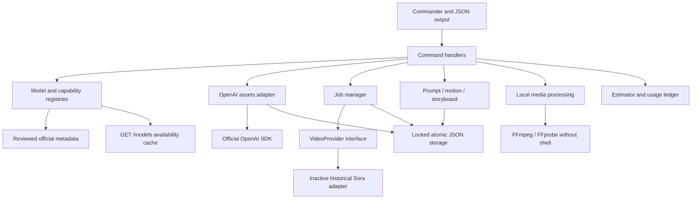

# Architecture

ESM, strict TypeScript, Node LTS. The executable delegates to Commander definitions; commands orchestrate library modules. Domain services are exported independently of terminal output.

| Module | Responsibility |
| --- | --- |
| `src/cli` | Entrypoint, context, output envelope, stderr UI, signals |
| `src/commands` | Parsing and domain orchestration |
| `src/api` | Fixed official SDK origin, image and text requests, paid operation journal |
| `src/providers` | Optional native video operations and provider registration |
| `src/registry` | Evidence, model status, capability gates, account discovery |
| `src/prompt` | Structured prompt schema, 19 fields and 13 templates |
| `src/motion` | Masks, regions, normalized coordinates, textual approximation |
| `src/storyboard` | DAG validation, bounded scheduler, scene states, final assembly |
| `src/jobs` | Persistent states, polling, cancellation distinctions, asset downloads |
| `src/storage` | Cross-process file locking and atomic commits |
| `src/cost` | Evidence-based estimates, authorization, measured usage ledger |
| `src/config` | Strict persistent settings, environment-only credentials |
| `src/media` | Decoded metadata, safe process arguments, private temporary rendering |
| `src/errors`, `src/logging`, `src/utils` | Typed errors, redaction, paths, retry and SSRF boundaries |

## Evidence and availability

Reviewed documentation establishes functionality. Account `/models` discovery establishes only visibility and shutdown dates when supplied. Retired status always wins, even if an old model remains listed. Unknown models retain unknown capabilities. Reviewed supported metadata expires after 30 days; `--refresh` refreshes account availability, not documentation or pricing.

## Submission and recovery

Creation reserves a fingerprint and unique operation ID under a lock before issuing the request. This prevents simultaneous identical requests across CLI processes. Acceptance stores the remote ID. A failure after reservation is marked uncertain because remote acceptance cannot always be established. SDK creation retries are disabled. An identical request reuses its record; an explicit `--new-request` permits regeneration after the operator reviews possible charges.

This provides duplicate prevention, not distributed exactly-once delivery. A crash between remote acceptance and local commit can leave a reservation without a remote ID. It must be reconciled through provider records. No active video provider exists to expose an undocumented recovery endpoint. Provider adapters may use a `requestId` for idempotency only if their official API documents it.

Polling and downloads use bounded exponential backoff with jitter for transient errors; authentication errors fail immediately. Polling has a deadline. SIGINT/SIGTERM abort local operations, while remote creation and billing can continue. Local cancellation is recorded separately from remote cancellation and does not claim remote work was cancelled.

## Local outputs and downloads

Inputs are decoded with bounded Sharp or FFprobe. FFmpeg is spawned with `shell: false`, fixed filter names, numeric validation and `file,pipe` input protocols. Rendering uses a private directory in the output filesystem; success is inspected before a non-overwriting atomic hard-link publish. Temporary files are removed on failure. Network downloads require an adapter-specific exact hostname allowlist, HTTPS and public DNS results pinned for the request. Redirects are rejected. Length, content type and optional provider checksums are checked; SHA-256 is computed locally. Job downloads are decoded by FFprobe before the job references the output.

Filesystems used for state and outputs must support atomic rename, hard links and locking directories. Network filesystems with weak locking semantics require external coordination. Read-only command calls do not create state. Metadata writes use mode 0600 and newly created state directories use 0700 on POSIX; Windows ACLs follow the user's account.

## Dependency choices

Requested stack: Commander, Zod, Inquirer, Pino, OpenAI SDK, Vitest, tsup, Sharp and pnpm. Additional runtime dependencies: `yaml` provides bounded JSON/YAML composition; `proper-lockfile` provides maintained inter-process locking with stale-lock recovery; `ipaddr.js` classifies IPv4, IPv6 and mapped IPv4 for SSRF prevention; `chalk`, `ora` and `cli-progress` implement requested colors, spinners and progress bars. Development dependencies `tsx`, ESLint, typescript-eslint and type packages provide development execution and lint/type checks; Prettier keeps source formatting consistent. FFmpeg remains an OS dependency to avoid hidden binary downloads and licensing assumptions in the package.
